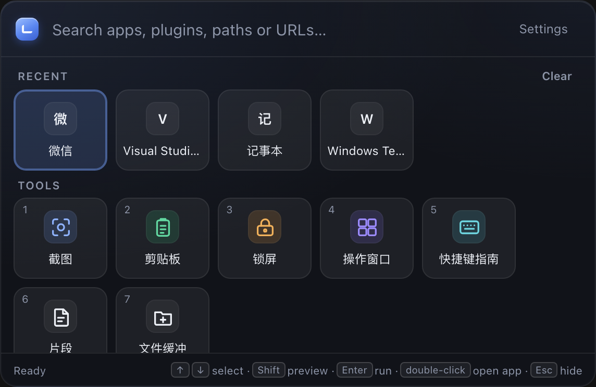
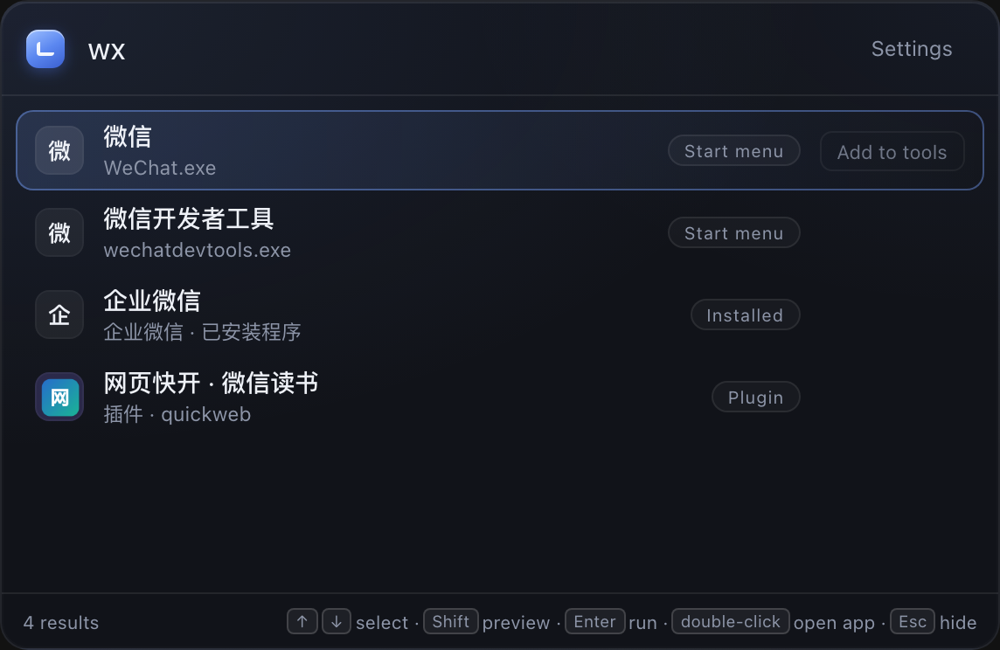
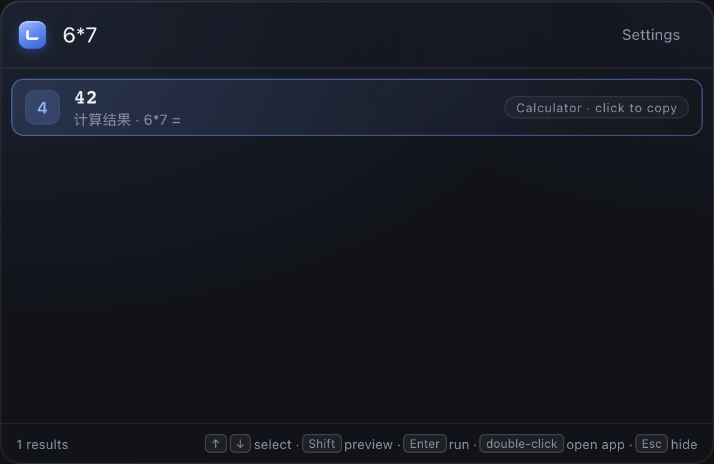
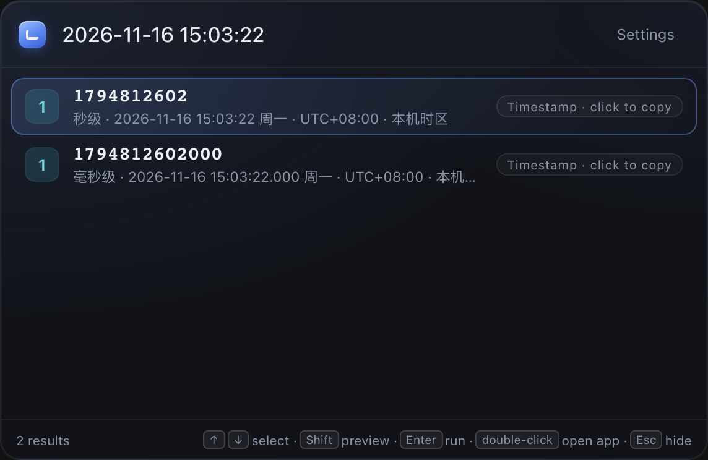
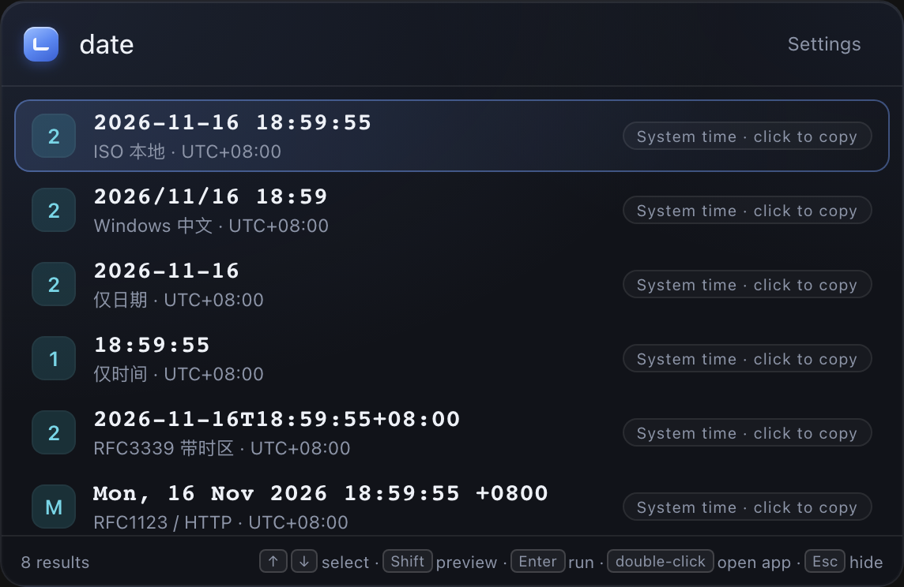
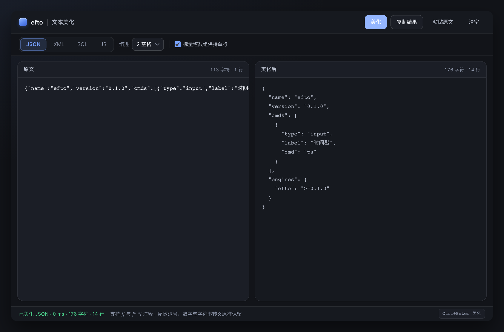
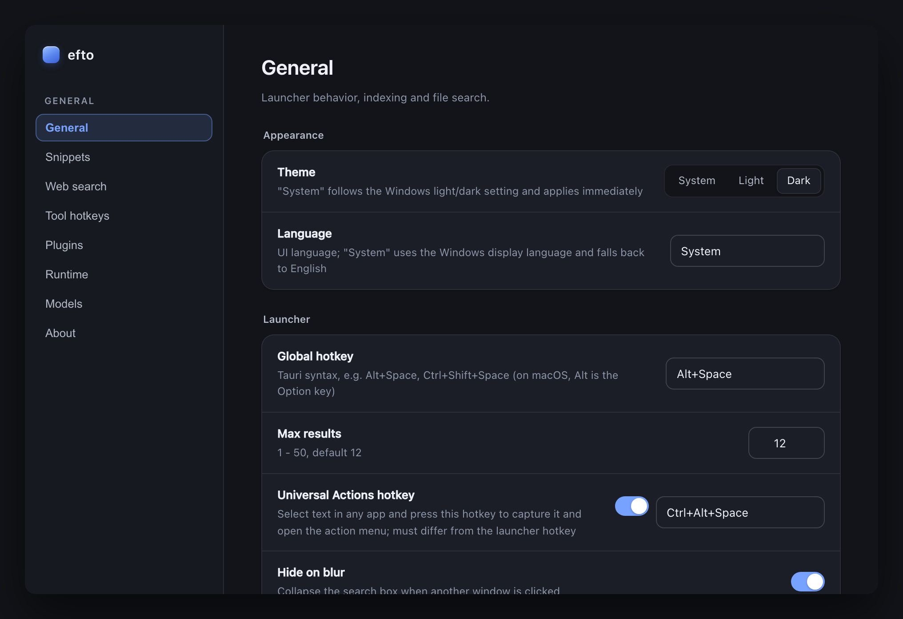

# efto

[English](README.md) · [简体中文](README.zh-CN.md)

Phase one: **fast app launching for Windows** + a **JS/TS plugin runtime**.
The desktop stack is Tauri 2, the plugin engine is an embedded V8 (rusty_v8 152), and TypeScript is stripped of its types in-process by SWC (via deno_ast) — no Node, npm, or tsc required.

```
Alt+Space → type → Enter to launch an app / open a plugin
```

> **About the name**: **efto** stands for **Efficiency Tools** — the goal is to collapse high-frequency actions like "find an app, open a file, run a small tool" into a single input box.
>
> The product identity is uniformly **efto**: cargo package names `efto-core` / `efto-jsrt` / `efto-app`, the `efto.exe` artifact,
> window title and tray, bundle id `app.efto.launcher`, data directory `~/.efto` (Windows: `C:\Users\<name>\.efto`),
> environment variables `EFTO_*`.
>
> Plugins only ever see efto's own contract: the `efto-plugin.json` manifest, `efto.*` / `window.efto`, and the `efto://` protocol.
> There is no compatibility layer for any third-party launcher.

## Screenshots

> Rendered from the shipped frontend pages (`scripts/gen-readme-shots.mjs`), so the images track the real UI —
> only the data on screen is sample data. Built-in command names, app names and result subtitles come from the
> backend and are still Chinese-only; everything else follows Settings → Language.

**Launcher panel** — empty input shows recently used apps, then pinned tools (`Alt+1` … `Alt+7`):



**App search** — `wx` (pinyin initials) finds 微信; plugin rows carry their own logo, `Enter` or double click runs:



**Calculator** — type an expression and the result becomes the first row; `Enter` or a single click copies it:



**Time → timestamp** — one moment, two rows (seconds and milliseconds); click copies that number:



**System time** — `date` / `now` / `时间` lists eight common formats; click copies the one you picked:



**Plugins** — `文本美化` (text-beautify): the original text on the left, the formatted result on the right, all local.
Plugin windows use the plugin's own markup, so their labels are the plugin author's:



**Settings** — hotkey, indexing, file search, plugins, runtimes and models in one window:



## What works today

| Capability | Status | Notes |
| --- | --- | --- |
| App launching | ✅ Verified | Start Menu `.lnk` files, registry uninstall entries, bare exes in `Program Files` and similar directories, a whitelist of built-in Windows tools |
| Chinese / pinyin search | ✅ Verified | `wx` / `weixin` → WeChat; `jsb` → Notepad; subsequence, initials, compact matching, usage-frequency weighting |
| Direct input | ✅ Verified | Typing a URL, `ms-settings:`, or an existing path opens it directly; **typing an expression puts the result in the dropdown, Enter copies it** |
| Time → timestamp | ✅ Verified | `2026-11-16 15:03:22` / `下午3点` / `明天 15:00` / `现在` → **two rows, seconds and milliseconds**; click to copy. Epoch values are independently cross-checked against Node's `Date` (the OS timezone database) |
| System time, many formats | ✅ Verified | `date` / `now` / `时间` / `现在` → **eight common formats** (ISO local, Windows slashes, date only, time only, RFC3339, RFC1123/HTTP, Chinese, filename-safe); click to copy that one format. Weekday and month names are independently verified against Node's ICU tables |
| JS plugins | ✅ Verified | `efto-plugin.json` + `main.js` (**CommonJS scope**); only `efto.*` is injected at runtime |
| TS plugins | ✅ Verified | `main.ts` transpiled in-host by SWC (type stripping); relative-path `require` of nested `.ts` modules works |
| Plugin UI | ⚠️ Code complete, never run in a real webview | The `efto://` protocol serves the plugin directory, the host injects `window.efto`, and UI ↔ main messaging works both ways |
| Plugin persistence | ✅ Verified | One JSON file per plugin, 10 MB quota; both the KV and document-style interfaces (`efto.db.put` / `allDocs`) can write |
| Everything file search | ✅ CLI verified end to end / ⚠️ UI rendering not exercised | Type directly in the search box (≥2 chars) → **file results are appended after the app entries** (no magic prefix); a single click selects, double click or Enter opens. Queries the local Everything index; Chinese paths are decoded correctly as GBK |
| Release artifacts | ✅ Verified (v0.1.0) | GitHub Releases ships a portable zip (`efto.exe` + `plugins/`), an NSIS installer, a macOS arm64 dmg, and individual plugin bundles; none are signed, and autostart plus auto-update are still unimplemented |

**Real data and the verification process live in `docs/verification.md`** (unit tests, parsing metrics over 204 real shortcuts, end-to-end CLI verification plus an independent Node time probe, and an explicit list of what has *not* been verified).

Unimplemented capabilities **fail loudly** instead of silently succeeding: `node_modules` dependency resolution, desktop shortcuts, UWP/MS Store apps, and ESM-syntax entry points (see below). Details in `docs/roadmap.md`.

## Download

Artifacts are published on [Releases](https://github.com/liminshanlm/efto/releases):

| Artifact | Purpose |
| --- | --- |
| `efto-<ver>-windows-x64-portable.zip` | Portable: unzip and `efto.exe` sits next to `plugins/`; double-click to run, nothing written to the registry |
| `efto_<ver>_x64-setup.exe` | NSIS installer: installs to the machine, plugins bundled in |
| `efto-<ver>-macos-arm64.dmg` | macOS Apple Silicon (arm64): ad-hoc signed, not notarized, so on first launch use right-click → Open, or `xattr -dr com.apple.quarantine /Applications/efto.app` |
| `<plugin>-<version>.zip` | A single plugin: use Settings → Import Plugin, or unzip into `~/.efto/plugins/<name>/` |

Requires Windows 10/11 x64 with the WebView2 Runtime installed (bundled with Win11; on Win10 it is usually already there via Edge updates).
macOS builds are Apple Silicon only — no Intel build yet.
Artifacts are not code-signed, so SmartScreen warns about an unknown publisher: click **More info → Run anyway**.

Releases are built automatically by `.github/workflows/release.yml` when a `v*` tag is pushed. Maintainer steps:

```powershell
# bump the version in crates/app/tauri.conf.json first, then tag it with the same name
git tag v0.1.0
git push origin v0.1.0
```

## Repository layout

```
crates/
  core/     app discovery, .lnk parsing, indexing, search scoring, plugin manifests, storage  ← no UI / no JS deps, unit-testable on its own
  jsrt/     rusty_v8 engine, efto API shim, TS transpilation, capability thread pool
  app/      Tauri 2 host: tray, hotkey, search window, efto:// protocol, Host capability impl
frontend/   search box (plain static HTML/CSS/JS, no bundler)
plugins/    the 12 bundled plugins listed below; timestamp-ts is the TS + require example
plugin-sdk/ efto.d.ts — type hints for TS plugin authors
scripts/    vsenv / cargo / gen-icons / dev-run / bootstrap / package-plugins / gen-readme-shots
vendor/     where the prebuilt V8 static library lands (fetched by bootstrap, gitignored — see below)
```

### Bundled plugins

| Plugin | What it does |
| --- | --- |
| `timestamp-ts` | Time ↔ timestamp conversion; also the TS + nested-`require` example |
| `translate` | Translates input with the default model from Settings → Model (OpenAI-compatible), auto CN↔EN |
| `ai-chat` | AI chat: multiple sessions, streaming output, Markdown rendering, image input |
| `ocr` | OCR: pick or drop an image and extract text / tables / formulas (the model must accept image input) |
| `markdown` | Markdown preview and editing: document and source modes, open or drop files, save, export HTML, print |
| `text-beautify` | Pretty-prints JSON / XML / SQL / JS into properly indented multi-line form; original on the left, result on the right |
| `quickweb` | Web quick-launch: a trigger word opens a site, extra keywords run an in-site search (52 built-ins, customizable) |
| `api-manager` | API management and testing: collections, environment variables, history, import/export; usable from the UI, commands, and the CLI |
| `file-share` | LAN file sharing: exposes files and folders over read-only HTTP to devices on the same subnet |
| `ipmsg` | LAN instant messaging — only between devices running efto (not IPMSG-compatible): auto-discovery, lookup by IP, text and file transfer, first contact needs consent |
| `hosts` | Edits the hosts file on Windows/macOS: view, add, modify, delete, enable/disable mappings; auto-backup, elevation on write |
| `dev-tools` | baiy/Ctool's developer toolbox adapted for efto — 46 tools: hashing, crypto, encoding, date/time, QR codes, JSON, regex, diff, unit conversion |

## Build

Prerequisites: Windows 10/11, the WebView2 Runtime (usually already present on Win10), Visual Studio with the **Desktop development with C++** workload, and Rust stable.

```powershell
# 1) one-time toolchain setup (rustup via the rsproxy mirror; VS components need UAC)
powershell -ExecutionPolicy Bypass -File scripts/bootstrap.ps1

# 2) build + unit tests
powershell -ExecutionPolicy Bypass -File scripts/cargo.ps1 -Cmd "test --workspace"

# 3) run it (enters the MSVC dev environment and registers the repo's plugins/ as a plugin directory)
powershell -ExecutionPolicy Bypass -File scripts/dev-run.ps1
```

### Two environment traps (already hit, already handled in the scripts)

1. **Git Bash's `link.exe` hijacks the MSVC linker.** `/usr/bin/link.exe` is coreutils' hardlink tool, and rustc only looks for `link.exe` on PATH, so every build-script link fails with `link: extra operand`. `scripts/vsenv.ps1` imports the `VsDevCmd.bat` environment first, then strips `\usr\bin` and `\mingw64\bin` off PATH. **Do not** run cargo directly inside Git Bash.
2. **The prebuilt rusty_v8 library is downloaded from GitHub Releases by default**, which times out on some networks. `scripts/bootstrap.ps1` fetches it into `vendor/rusty_v8/` (38 MB, gitignored, not committed), and `.cargo/config.toml` points `RUSTY_V8_ARCHIVE` + `RUSTY_V8_ARCHIVE_SHA256` at that path so later builds work offline. If the direct connection fails, set the mirror before running bootstrap:
   ```powershell
   $env:RUSTY_V8_MIRROR = "https://gh-proxy.com/https://github.com/denoland/rusty_v8/releases/download/{tag}/{file}"
   ```

## Usage

- **Alt+Space** shows/hides the search box (change `hotkey` in `settings.json`)
- Type an app name, pinyin, or initials → `↑`/`↓` to select, `Enter` to run, `Esc` to back out one level at a time
- **Mouse**: for regular apps a **single click only selects and a double click runs** (no accidental launches); calculator results and timestamps **select and copy on a single click**
- `Alt+R` rebuilds the index; `Alt+P` shows the plugin list; the tray menu has the same entries
- Type `https://…`, `ms-settings:`, or an existing folder path → it opens directly.
  `ms-settings:` lists common settings pages (e.g. `ms-settings:display`) and filters as you keep typing
- Type an expression → the first row is the result and `Enter` copies it to the clipboard. Supports `+ - * / % ^`, parentheses,
  unary minus, `pi/e/tau`, functions like `sqrt log ln round floor ceil abs sin cos tan min max pow`,
  `kb/mb/gb/tb` unit conversion, thousands separators `1,000+1`, full-width `１＋１`, and a trailing `=`.
  The gate is strict: **it never hijacks app search** — `chrome`, `3.10 64-bit`, `1700000000` (pure digits),
  `(5)` (parentheses only), and `1/0` (divide by zero) produce no calculator row.
- Type a plugin keyword (e.g. `时间戳 1700000000`) → the plugin backend starts and opens, with the remaining input passed to the plugin as payload
- Type directly in the search box (≥2 chars) → **Everything file search, results appended after the app entries**
  (no magic prefix; silently absent when es/Everything is unavailable — check Settings for availability).
  The query string is passed to Everything syntax verbatim: `报告 ext:pdf`, `size>10mb`. Each row shows
  filename + containing directory + size + modified time, and **a single click only selects while double click (or Enter) opens**,
  consistent with other runnable rows.
  At most 5 rows, scored below app entries so apps are never pushed out; `$RECYCLE.BIN`, `node_modules`,
  `Temp`, `WinSxS`, and `.git` are filtered by default (in practice `ext:exe` used to return a first screen full of Recycle Bin entries).
- Type a time → **two timestamp rows, seconds and milliseconds**; click or `Enter` copies the bare number (what you see is what you copy).
  Supports `2026-11-16`, `2026/11/16 15:03:22`, `2026.11.16`, `20261116`, `2026-11-16T15:03:22Z`,
  `2026年11月16日15时03分22秒`, `下午3点`, `上午10点半`, `11月16日` (this year), `15:03` (today),
  `今天/昨天/明天/后天`, `现在`/`now` (the millisecond row is genuinely sub-second), explicit timezones `+08:00`/`UTC`, and full-width digits.
  The gate is equally strict: **it neither hijacks app search nor fights the calculator** —
  `chrome`, `2026` (a light-year), `1700000000` (already a timestamp), `3.10 64-bit`,
  `11/12/2026` (ambiguous between Nov 12 and Dec 11, so it gives up), and `11-16` (left to subtraction) produce no time row;
  conversely `2026-11-16` silences the calculator (which used to helpfully compute 1,999).
- Type `date` / `now` / `time` / `today` / `时间` / `日期` / `现在` / `当前` / `今天` / `系统时间`
  → **the system time in eight common formats**; click to copy that one format:

  ```
  2026-11-16 18:59:55              ISO local
  2026/11/16 18:59                 Windows slashes
  2026-11-16                       date only
  18:59:55                         time only
  2026-11-16T18:59:55+08:00        RFC3339 (with timezone offset)
  Mon, 16 Nov 2026 18:59:55 +0800  RFC1123 / HTTP Date header
  2026年11月16日 18时59分55秒 周一     Chinese
  20261116_185955                  filename-safe (no separators)
  ```

  Three rules: **the trigger must match the whole string** (`update`, `dated`, `datetime`, and `date 2026-11-16` do not trigger —
  they search apps or parse a timestamp); **one moment per screen** (the eight rows and the two timestamp rows come from a single
  clock read, so no two different instants appear across a second boundary); and **apps are never buried** (there really is a
  `date.exe` on this machine, and its exact match at ≈1000 still ranks above the format rows at ≈700).

> The window/hotkey/tray layer needs one manual confirmation on a machine with foreground focus: this project's automated
> verification goes through the CLI channel below, because remote desktop sessions steal focus and you cannot reliably assert
> that "the window really popped up".

## Verifying the GUI locally

Everything automation can cover is covered (see `docs/verification.md`); the remaining steps need eyes, about 2 minutes:

```powershell
# 1) run the release artifact directly (no dev environment needed)
$env:EFTO_PLUGIN_DIRS = "E:\workspace\efto\plugins"   # if you want the repo's sample plugins
& E:\workspace\efto\target\release\efto.exe

# 2) press Alt+Space — a centered search box should appear
# 3) type jsb or 记事本 → Enter launches; Esc closes; clicking another window auto-hides
# 4) mouse: a single click on an app row only highlights it, double click launches; type 6*7 then single-click the result row → copies and dismisses
#    type 2026-11-16 15:03:22 → two rows (seconds / milliseconds) should appear; single-click either to copy that number
#    type date or now → eight system-time formats should appear; single-click copies the one you picked
# 5) type 时间戳 abc → a system notification should fire (timestamp-ts' parse-failure path)
#    type 网页快开 → the plugin UI window should open (quickweb)
# 6) right-click the tray icon: show search box / rebuild index / open plugin directory / quit
```

Item-by-item checklist (whichever item is wrong points at that module):

| Symptom | Notes | If it doesn't match |
| --- | --- | --- |
| A borderless, centered, translucent input bar appears | `app.windows` in `tauri.conf.json` | Check `decorations/transparent/center`; re-run `cargo build` after config changes |
| Typing yields results and `↑↓` moves the highlight | `search` command + frontend rendering | Set `$env:RUST_LOG="debug"` and see whether `search` errors |
| `Enter` actually launches the program | `invoke_hit` → `ShellExecute` | Look for `已启动 pid=` in the log |
| Clicking outside hides the window | `hide_on_blur` | Turn it off in Settings to reproduce and compare |
| The tray menu appears | `tray.rs` | The icon may be tucked into the notification-area overflow — expand it first |
| The plugin UI page renders content | `efto://` protocol + injected SDK | Look for `Asset ... not found` or a protocol 403/404 in the log |
| **No black console window covers the desktop** | `windows_subsystem` + `AttachConsole` | Fixed in this round; if it reproduces, the build didn't take effect |

If the hotkey is taken (WeChat / QQ / an IME can also grab Alt+Space): change `hotkey` in `~/.efto/settings.json` and restart.
Hotkey rebinding only runs at startup and in `set_settings`, so runtime edits need a restart.

## Using it without the GUI: the cli channel

The same binary exposes a `cli` subcommand for scripted verification, CI, and plugin authors testing their own main logic:

```powershell
$env:EFTO_PLUGIN_DIRS = "E:\workspace\efto\plugins"
.\target\debug\efto.exe cli index                      # rebuild the index + stats (--json for machine-readable output)
.\target\debug\efto.exe cli search chrome              # add --json for structured results
.\target\debug\efto.exe cli search chrome --limit 5 --kind app --exact   # limit count/kind/exact match
.\target\debug\efto.exe cli launch 记事本 --dry-run      # resolve the hit, report only, launch nothing
.\target\debug\efto.exe cli launch --id "<id from search>"              # launch by id, convenient for agents
.\target\debug\efto.exe cli apps --limit 20 --json     # enumerate indexed apps
.\target\debug\efto.exe cli plugins                    # discovered plugins, entry points, problems
.\target\debug\efto.exe cli plugin-run timestamp-ts ts 1700000000   # actually run a plugin once
.\target\debug\efto.exe cli files "D:\报告.docx" --reveal            # reveal in Explorer
.\target\debug\efto.exe cli action reindex             # host actions (reindex/open_plugin_dir/open_data_dir/lock_screen)
.\target\debug\efto.exe cli ps --json                  # visible top-level windows (pid/hwnd/process/title)
.\target\debug\efto.exe cli focus --pid 1234           # bring a window to the foreground (or match a title keyword)
.\target\debug\efto.exe cli capabilities --json        # capability inventory: subcommands, flags, exit codes, file-search status
pwsh scripts/verify.ps1                                # the end-to-end combination of the above
```

Logs always go to stderr; with `--json`, stdout contains only JSON. On failure it prints
`{"ok":false,"code":"...","message":"..."}`.

Exit codes: `0` success, `1` execution failure (e.g. launch failed, GUI-only action), `2` usage error,
`3` no results — so scripts can tell "nothing found" apart from "something broke".

`--dry-run` (`launch` / `files` / `action` / `focus`) only reports what would happen, with no side effects;
`--no-track` stops `launch` from writing a usage record, so automation can call it repeatedly without polluting
recommendation ranking.

`plugin-run` starts the plugin backend, delivers one `onPluginEnter`, collects events, and echoes capability calls
(`[notify]` / `[copy]` / `[ui-msg:*]`); it exits non-zero on an `Error` event — ready to drop straight into CI.

Config lives in `~/.efto/settings.json` (Windows: `C:\Users\<name>\.efto\settings.json`, created on first launch).
The index cache is `app-index.json`, usage records are `usage.json`, and plugin data is `plugin-data/<plugin-name>.json`.
Logging goes through `tracing`; set `$env:RUST_LOG = "debug"` and rerun to see details of plugin threads, capability
calls, and protocol requests.

## Writing a plugin

The smallest plugin is two files (`efto-plugin.json` + `main.js`) dropped into `~/.efto/plugins/my-plugin/`
(or point `EFTO_PLUGIN_DIRS` at your working directory during development):

```json
{ "name": "my-plugin", "version": "1.0.0", "main": "main.js",
  "cmds": [{ "type": "input", "label": "My Plugin", "cmd": "my" }] }
```

```js
// main.js
efto.onPluginEnter(({ code, payload }) => {
  efto.showNotification(`Received ${payload}`);
  efto.kv.set('last', payload);
});
```

The full API surface, TypeScript patterns, UI page messaging, and debugging tips are in **`docs/plugin-development.md`**;
the snippet above is the smallest JS plugin, and `plugins/timestamp-ts` is a runnable example.

A plugin can declare a host version requirement with `"engines": { "efto": ">=0.1.0" }`; when unmet, the plugin is
still listed (with the reason) but never enters search and cannot be invoked. To package a plugin directory into a distributable zip:

```powershell
powershell -ExecutionPolicy Bypass -File scripts/package-plugins.ps1            # all plugins
powershell -ExecutionPolicy Bypass -File scripts/package-plugins.ps1 -Only markdown
```

Output lands in `dist/plugins/<name>-<version>.zip`; the zip root *is* the plugin directory, so it can be imported
directly via Settings → Plugins, or unzipped into `~/.efto/plugins/`.

## Explicit boundaries

- No Node.js runtime: no `require('fs')`, no npm packages. File and system needs go through `efto.*` capabilities
  (`shell*`, `kv` / `db`, `node` / `python`); LLM calls go through `efto.ai` as configured in Settings.
- **The module format is CommonJS**: the entry point and every `require`d module run inside a function scope,
  so write `require('./x')` / `exports.f = …`, not `import`/`export`. When ESM is detected you get the concrete
  CJS rewrite instead of an inscrutable V8 syntax error. Real ESM support is phase two.
- TypeScript is **type stripping only**: `enum`, value-carrying `namespace`, decorators, and JSX are rejected with a
  "please precompile" message rather than emitting JS with different semantics.
- `efto.db` is local JSON (KV + document interface); there is no CouchDB-style replication/conflict merging or
  `_changes` sequence semantics.
- Icons are currently text-initial avatars; real `.lnk`/exe icon extraction is phase two (it needs shell APIs).
- UWP/MS Store apps and `App Paths` are not indexed; phase one only looks at the Start Menu, the registry, and install directories.

## License

MIT — see [LICENSE](LICENSE) for the full text. Sample plugins are free to reference and modify.

Third-party components distributed with the binary (V8, Tauri, deno_ast/SWC, MPL-2.0 and Unicode data, etc.) and their
license texts are in [THIRD_PARTY_LICENSES.md](THIRD_PARTY_LICENSES.md).

To contribute, see [CONTRIBUTING.md](CONTRIBUTING.md); for security issues and the plugin trust model, see [SECURITY.md](SECURITY.md).
